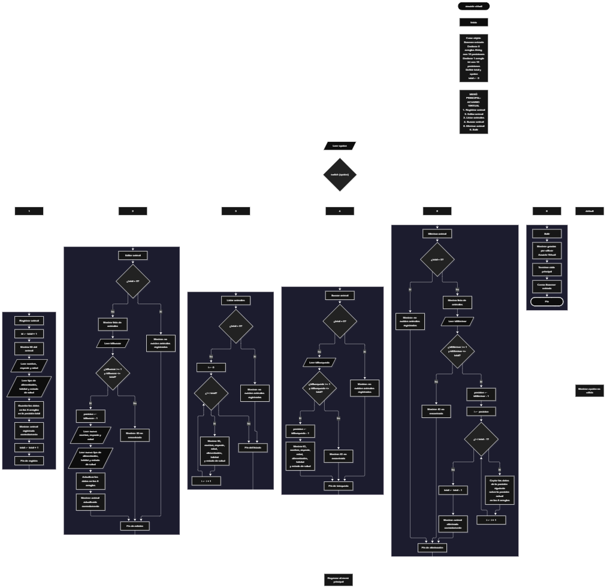

 

Este proyecto, llamado <b>acuario virtual</b>, fue desarrollado en <b>java</b> como un ejercicio práctico para fortalecer la lógica de programación mediante la creación de un sistema de gestión de animales desde la consola. El programa cuenta con un menú principal de seis opciones que permite <b>registrar, editar, listar, buscar y eliminar</b> los animales registrados, además de finalizar la ejecución del sistema. Cada animal almacena datos como el nombre, la especie, la edad, el tipo de alimentación, el hábitat y el estado de salud, utilizando seis arreglos con una capacidad de <b>10 animales durante la ejecución</b>. Durante su desarrollo se aplicaron conceptos fundamentales de programación, como variables, arreglos, estructuras condicionales, ciclos repetitivos y estructuras de selección, además de procesos para buscar, modificar, eliminar y organizar registros. Este proyecto permite poner en práctica los conocimientos adquiridos en Java y sirve como base para desarrollar sistemas de gestión más avanzados utilizando otros lenguajes y tecnologías.

<h2 align="center">⚙️ Funcionamiento del menú principal</h2>

### ➕ Registrar animal

La opción <b>1) registrar animal</b> permite almacenar un nuevo animal en el acuario virtual. Para comenzar, el programa calcula el identificador mediante la expresión <b>id = total + 1</b> y muestra el número correspondiente al animal que se va a registrar. Después, solicita el <b>nombre, especie, edad, tipo de alimentación, hábitat y estado de salud</b>. Los datos se almacenan en sus respectivos arreglos utilizando la posición indicada por la variable <b>total</b>. Finalmente, muestra el mensaje <b>"animal registrado correctamente."</b> e incrementa la variable <b>total</b> en uno para actualizar la cantidad de animales registrados. Los arreglos tienen una capacidad de 10 posiciones, aunque el código actual no incorpora una validación para impedir registros que superen ese límite.

### ✏️ Editar animal

La opción <b>2) editar animal</b> permite modificar la información de un animal registrado. Primero, el programa comprueba si existen animales almacenados mediante la condición <b>total == 0</b>. Si no hay registros, muestra el mensaje <b>"no existen animales registrados."</b>. En caso contrario, presenta una lista con el ID, nombre, especie, edad, alimentación, hábitat y estado de salud de cada animal. Después, solicita el ID del animal que se desea editar y comprueba que esté dentro del rango permitido mediante la condición <b>idBuscar &gt;= 1 y idBuscar &lt;= total</b>. Si la selección es válida, calcula la posición correspondiente mediante <b>posicion = idBuscar - 1</b> y solicita los nuevos datos del animal. La información se actualiza directamente en los seis arreglos. Finalmente, muestra el mensaje <b>"animal actualizado correctamente."</b>. Si el ID seleccionado no corresponde a un animal registrado, presenta el mensaje <b>"ID no encontrada."</b>.

### 📋 Listar animales

La opción <b>3) listar animales</b> permite visualizar todos los animales registrados actualmente en el acuario virtual. Antes de mostrar la información, el programa comprueba si la variable <b>total</b> es igual a cero. Si no existen registros, presenta el mensaje <b>"no existen animales registrados."</b>. Si hay animales disponibles, utiliza un ciclo <b>for</b> para recorrer los arreglos desde la primera posición hasta el número total de animales registrados. Durante el recorrido, muestra el ID, nombre, especie, edad, alimentación, hábitat y estado de salud de cada animal. Esta función facilita consultar los registros existentes sin necesidad de buscar cada animal individualmente.

### 🔎 Buscar animal

La opción <b>4) buscar animal</b> permite localizar un animal registrado mediante su ID. Primero, el programa comprueba si existen animales almacenados. Si el acuario está vacío, muestra el mensaje <b>"no existen animales registrados."</b>. En caso contrario, solicita el identificador del animal que se desea buscar y verifica que se encuentre dentro del rango permitido mediante la condición <b>idBusqueda &gt;= 1 y idBusqueda &lt;= total</b>. Si el ID es válido, calcula la posición correspondiente utilizando <b>posicion = idBusqueda - 1</b> y muestra los datos completos del animal encontrado: nombre, especie, edad, alimentación, hábitat y estado de salud. Si el ID introducido no corresponde a un registro existente, presenta el mensaje <b>"ID no encontrada."</b>.

### 🗑️ Eliminar animal

La opción <b>5) eliminar animal</b> permite eliminar un animal registrado mediante su ID. Antes de comenzar, el programa comprueba si existen animales almacenados. Si el acuario está vacío, muestra el mensaje <b>"no existen animales registrados."</b>. Si hay registros disponibles, presenta una lista con los datos de cada animal. Después, solicita el ID del animal que se desea eliminar y comprueba que esté dentro del rango válido. Si el animal existe, calcula su posición mediante <b>posicion = idEliminar - 1</b> y comienza el proceso de eliminación. Para mantener los registros organizados, utiliza un ciclo <b>for</b> que desplaza una posición hacia atrás los datos de los animales posteriores en los seis arreglos: <b>nombres, especies, edades, alimentaciones, habitats y estadosSalud</b>. Posteriormente, disminuye la variable <b>total</b> en uno y muestra el mensaje <b>"animal eliminado correctamente."</b>. Si el ID seleccionado no corresponde a un animal registrado, presenta el mensaje <b>"ID no encontrada."</b>. La última posición deja de formar parte de los registros activos, aunque sus valores no se limpian expresamente.

### 🚪 Salir del menú principal

La opción <b>6) salir</b> está destinada a finalizar la ejecución del programa y muestra el mensaje <b>"gracias por utilizar acuario virtual."</b>. El menú principal se encuentra dentro de una estructura repetitiva <b>do-while</b>, que mantiene el programa en funcionamiento mientras se realizan las operaciones disponibles. Cuando el usuario selecciona la opción 6, la condición <b>opcion != 6</b> deja de cumplirse y el ciclo termina. Finalmente, se ejecuta la instrucción <b>entrada.close()</b> para cerrar el objeto Scanner utilizado durante la captura de datos.

<h2 align="center">🧠 Temas aplicados en el proyecto</h2>

### 📦 Variables

En este proyecto se utilizan variables para almacenar la opción seleccionada en el menú, controlar la cantidad de animales registrados, calcular los identificadores, seleccionar las posiciones de los registros que se desean editar, buscar o eliminar, y recorrer los arreglos durante las diferentes operaciones. Cada variable cumple una función específica dentro de la gestión de animales.

🔢 **Opcion:** Almacena la opción seleccionada por el usuario en el menú principal.

📊 **Total:** Controla la cantidad actual de animales registrados.

🆔 **Id:** Calcula el identificador que se muestra al registrar un nuevo animal.

🔎 **IdBuscar:** Almacena el ID introducido para seleccionar el animal que se desea editar.

🔍 **IdBusqueda:** Almacena el ID introducido para buscar un animal.

🗑️ **IdEliminar:** Almacena el ID del animal que se desea eliminar.

📍 **Posicion:** Calcula la posición del arreglo correspondiente al ID seleccionado.

🔄 **I:** Funciona como contador en los ciclos <b>for</b> utilizados para recorrer los registros y reorganizar los arreglos.

### 🗃️ Arreglos

En este proyecto se utilizan seis arreglos relacionados con los datos de cada animal. Cada arreglo tiene una capacidad de <b>10 posiciones</b> y utiliza el mismo índice para representar la información correspondiente a un mismo registro. Por ejemplo, los datos de un animal almacenado en la posición <b>0</b> se encuentran distribuidos entre <b>nombres[0], especies[0], edades[0], alimentaciones[0], habitats[0] y estadosSalud[0]</b>. Esta organización permite recorrer, buscar, modificar, mostrar y eliminar los animales de manera ordenada.

🐠 **Nombres[10]:** Almacena los nombres de los animales registrados.

🧬 **Especies[10]:** Almacena las especies de los animales.

🔢 **Edades[10]:** Almacena las edades de los animales mediante valores enteros.

🥗 **Alimentaciones[10]:** Almacena los tipos de alimentación de los animales.

🌊 **Habitats[10]:** Almacena los hábitats de los animales.

❤️ **EstadosSalud[10]:** Almacena los estados de salud de los animales.

### 🔀 Estructuras condicionales

En este proyecto se utilizan las estructuras <b>if</b> y <b>else</b> para comprobar si existen animales registrados antes de realizar determinadas operaciones y verificar que el ID introducido por el usuario corresponda a un registro existente. Estas condiciones permiten controlar el acceso a las operaciones de edición, búsqueda y eliminación, además de determinar si se deben mostrar los datos de los animales o informar que no existen registros disponibles.

### 🔄 Estructuras repetitivas

En este proyecto se utilizan los ciclos <b>for</b> y <b>do-while</b>. Los ciclos <b>for</b> permiten recorrer los arreglos para mostrar los animales registrados y reorganizar los datos durante la eliminación de un registro. Por otro lado, el ciclo <b>do-while</b> mantiene activo el menú principal para que el usuario pueda ejecutar diferentes operaciones antes de salir del programa. De esta manera, las estructuras repetitivas permiten automatizar los recorridos y mantener el funcionamiento continuo del sistema.

### 🎯 Estructura switch

El programa utiliza la estructura <b>switch</b> para evaluar el valor almacenado en la variable <b>opcion</b> y ejecutar el bloque de instrucciones correspondiente. Cada caso representa una operación específica del sistema: <b>registrar, editar, listar, buscar, eliminar o salir</b>. También se utiliza el bloque <b>default</b> para mostrar el mensaje <b>"opcion no valida."</b> cuando el usuario introduce un número que no coincide con ninguna de las opciones definidas en el menú.

### 🔢 Dimensionamiento de arreglos

El programa utiliza la creación de arreglos mediante la instrucción <b>new</b> para establecer la capacidad de los espacios que almacenan la información de los animales. Se definieron seis arreglos de <b>10 posiciones</b>, lo que permite almacenar hasta 10 animales durante la ejecución. La cantidad de posiciones ocupadas se controla mediante la variable <b>total</b>, por lo que las operaciones recorren únicamente los registros comprendidos entre la primera posición y el total actual de animales. El código no incorpora una comprobación que impida superar la capacidad establecida.

### 🔄 Reorganización de registros

Cuando se selecciona un animal para eliminarlo, el programa utiliza un ciclo <b>for</b> que comienza en la posición seleccionada y continúa mientras <b>i &lt; total - 1</b>. En cada repetición, los datos de la posición siguiente se copian sobre la posición actual en los seis arreglos: <b>nombres, especies, edades, alimentaciones, habitats y estadosSalud</b>. Después, la variable <b>total</b> disminuye en uno. De esta manera, los animales posteriores ocupan las posiciones disponibles sin dejar espacios vacíos entre los registros activos.

<h2 align="center">¿Cómo se implementaron las operaciones crud en el proyecto?</h2>

Las operaciones <b>crud</b> se implementaron mediante las opciones del menú principal, permitiendo administrar los animales registrados. La operación <b>crear</b> corresponde a <b>registrar animal</b>, donde se introducen los datos de un nuevo registro; <b>leer</b> se realiza mediante las opciones <b>listar animales y buscar animal</b>; <b>actualizar</b> corresponde a <b>editar animal</b>, donde se modifican los datos de un animal registrado; y <b>eliminar</b> se realiza mediante la opción <b>eliminar animal</b>. Estas operaciones utilizan variables, arreglos, condicionales y ciclos para gestionar la información almacenada temporalmente durante la ejecución del programa.

<h2 align="center">Diagrama de flujo del proyecto</h2>

<h2 align="center">🛡️ Validaciones del programa</h2>

### 📭 No existen animales registrados

Esta validación se utiliza en las opciones de <b>editar, listar, buscar y eliminar</b>. El programa comprueba si la variable <b>total</b> es igual a <b>0</b> y, si no existen animales registrados, muestra el mensaje <b>"no existen animales registrados."</b>. Esta comprobación evita continuar con las operaciones que necesitan información almacenada cuando el acuario está vacío.

### ❌ ID no encontrada

Esta validación se utiliza durante las operaciones de <b>editar, buscar y eliminar</b>. El programa comprueba que el ID introducido por el usuario sea mayor o igual a <b>1</b> y menor o igual al valor de <b>total</b>. Si el identificador está dentro del rango permitido, calcula la posición correspondiente dentro de los arreglos. En caso contrario, muestra el mensaje <b>"ID no encontrada."</b>. Esta comprobación evita acceder a posiciones que no corresponden a animales registrados.

### ⚠️ Capacidad de los arreglos

Los seis arreglos utilizados en el proyecto tienen una capacidad de <b>10 posiciones</b>. Sin embargo, el código actual no incorpora una condición que compruebe si la variable <b>total</b> es menor que 10 antes de registrar un nuevo animal. Por esta razón, si se intenta almacenar un animal después de ocupar las diez posiciones disponibles, el programa puede producir un error al intentar acceder a una posición fuera de los límites del arreglo.

### ⚠️ Opción no válida

La estructura <b>switch</b> incluye el bloque <b>default</b>, que muestra el mensaje <b>"opcion no valida."</b> cuando el usuario introduce un número que no corresponde a ninguna de las seis opciones definidas en el menú. Esta alternativa permite informar al usuario cuando selecciona una operación que no está disponible.

<h2 align="center">🎯 Objetivo del proyecto</h2>

El objetivo principal de este proyecto es fortalecer la <b>lógica de programación</b> mediante el desarrollo de un sistema de gestión de animales en <b>java</b>. A través de su construcción se busca aplicar los conocimientos adquiridos sobre variables, arreglos, estructuras condicionales, ciclos repetitivos y estructuras de selección, integrándolos para resolver un problema de manera organizada. Además, el proyecto permite comprender cómo registrar, consultar, modificar y eliminar información en una aplicación de consola, estableciendo una base para desarrollar sistemas de gestión más completos con otros lenguajes y tecnologías.

